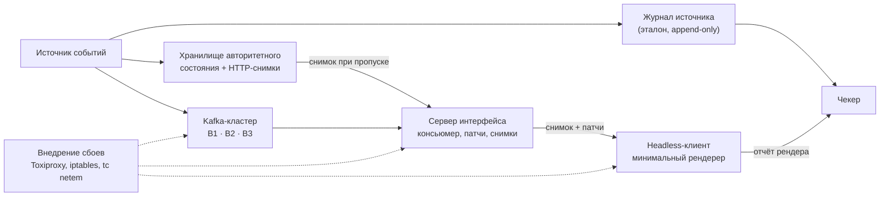

# Выпускная квалификационная работа: главы 1 и 2

**Тема:** Протокол доставки состояния серверно-управляемого интерфейса с версиями поддеревьев и его оценка при сбоях доставки через Apache Kafka.

**Участницы:** Дарья Николаева — часть A (протокол и клиент, BDUI); Мария Ильина — часть B (стенд: Kafka и чекер, оценка).

---

# Глава 1. Введение

## 1.1. Предпосылки

Серверно-управляемые интерфейсы (Server-Driven UI, SDUI; в русскоязычных источниках также BDUI) позволяют серверу определять всё представление клиентского приложения или его часть: структуру компонентов, их свойства и доступные действия. Такой подход позволяет менять интерфейс без выпуска новой версии клиента. Промышленным примером служит платформа Ghost Platform компании Airbnb [1]. Академические работы описывают отделение описания интерфейса от клиентской реализации [2, 3], а отраслевая оценка подхода и его рисков приведена в [4].

В событийно-ориентированных системах состояние, которое показывает интерфейс, может обновляться по событиям, доставляемым через брокер сообщений. В работе в качестве слоя доставки рассматривается Apache Kafka. Порядок записей Kafka сохраняет только внутри партиции, а гарантии доставки зависят от партиционирования, настроек производителя, репликации и обработки смещений потребителем. Поэтому восстановление на уровне приложения нужно рассматривать вместе с гарантиями брокера [5–7]. Заявленные гарантии нарушаются и на практике: например, независимая проверка Jepsen выявила нарушения у Kafka-совместимой системы Bufstream (сам Apache Kafka в ней не проверялся) [8]. Если обновление пропущено, продублировано или применено не по порядку, интерфейс может показать устаревшие данные или состояние, которое не соответствует текущему состоянию источника.

Эти сбои важны потому, что корректность нельзя оценивать только тем, обработал ли потребитель событие в конце концов. Система, с которой работает пользователь, должна ещё ограничивать время показа неверного или устаревшего состояния и контролировать сетевой трафик, нужный для восстановления. Механизм восстановления, который передаёт меньше данных, полезен только тогда, когда сохраняет требуемые свойства согласованности.

## 1.2. Постановка проблемы и пробел в исследованиях

Распространённая стратегия восстановления использует одну версию на весь экран. Так проще проверять версии, но при пропуске обновления клиенту может потребоваться перезагрузить экран целиком. Альтернатива — версионировать поддеревья интерфейса независимо и пересинхронизировать только затронутое поддерево. Это может сократить время и трафик восстановления, но порождает новый вопрос согласованности: каждое поддерево по отдельности может быть корректным, а их сочетание — соответствовать разным моментам истории источника и никогда не существовать как целое состояние.

Для бэкенда подобные эффекты изучены хорошо [6, 9]. Для интерфейса в изученных источниках остаются без ответа вопросы: какую долю времени пользователь видит неверные данные, насколько они устаревают и за какое время интерфейс восстанавливается. Надёжность сети названа среди открытых проблем SDUI в [2].

Близкие задачи решаются существующими практиками: серверной отрисовкой обновлений интерфейса, версионированной синхронизацией данных, частичной репликацией и возобновляемыми потоками событий [10–14]. Однако эти механизмы сами по себе не дают экспериментального сравнения SDUI с версиями поддеревьев, версионирования на уровне экрана и практической стратегии восстановления на Kafka при управляемых сбоях доставки. Исследовательский пробел состоит в том, что такие стратегии нужно оценить на воспроизводимых сценариях сбоев с независимым эталоном истории источника, измеряя одновременно безопасность отдельных поддеревьев, согласованность их сочетания и показатели восстановления. Насколько удалось найти (раздел 2.6 и Приложение А), такие сравнения не проводились; это утверждение будет уточнено после завершения протокола поиска.

Пробел заслуживает исследования, так как стратегия, снижающая стоимость восстановления, может одновременно увеличивать время, в течение которого экран комбинирует состояния из разных точек истории источника. Этот компромисс нужно измерять, а не предполагать.

## 1.3. Цель, задачи, объект, предмет и исследовательские вопросы

**Цель** работы — разработать протокол доставки состояния серверно-управляемого интерфейса, который версионирует поддеревья независимо, и экспериментально оценить его поведение относительно базовых стратегий при сбоях в цепочке доставки через Apache Kafka.

**Задачи:**

1. Провести обзор подходов к SDUI, гарантий доставки Kafka и методов проверки согласованности распределённых систем, выполнив и задокументировав поиск литературы.
2. Сформулировать критерий согласованности интерфейса, включая согласованность между поддеревьями, и метрики M1–M6.
3. Разработать протокол S4 с версиями поддеревьев и частичной ресинхронизацией, клиентскую логику в общем модуле и минимальный рендерер, достаточный для экспериментов.
4. Реализовать базовые стратегии S3 и S5, а также S1 как нижнюю контрольную точку.
5. Построить стенд: Kafka-кластер, подсистему внедрения сбоев, журнал источника событий, хранилище авторитетного состояния для восстановления и чекер согласованности.
6. Проверить чекер на подсаженных нарушениях, зафиксировать сценарии и критерии успеха, провести основные прогоны и определить условия, при которых восстановление на уровне поддеревьев выгодно, и компромиссы, которые ограничивают его применение.

**Объект исследования** — серверно-управляемые пользовательские интерфейсы в событийно-ориентированных системах. **Предмет исследования** — протоколы доставки состояния интерфейса и их поведение при сбоях в цепочке доставки через брокер сообщений.

**Общий вопрос.** Как доставлять состояние серверно-управляемого интерфейса так, чтобы при сбоях в цепочке «источник событий — Kafka — сервер интерфейса — клиент» пользователь не видел невозможных состояний, а после сбоя интерфейс быстро сходился к истинному состоянию, и какой ценой по трафику и задержке.

Исследование отвечает на следующие вопросы.

- **RQ1.** Как часто и как долго разные стратегии доставки нарушают определённое свойство безопасности при сбоях разных типов?
- **RQ2.** Улучшает ли S4 время сходимости и объём трафика восстановления по сравнению с S3 и практической базовой стратегией S5, не ухудшая безопасность на уровне поддерева сверх заранее заданной границы неуступаемости (non-inferiority margin)?
- **RQ3.** Какую цену согласованности вносит S4 из-за независимо версионируемых поддеревьев, измеряемую частотой и длительностью отображаемых сочетаний, которые не соответствуют ни одному состоянию истории источника?

**Объём работы.** Ядро работы составляют сравнение S4 с S3 и S5 на headless-клиентах и чекер. Дополнительно, при наличии времени, выполняются стратегия S2 (полный снимок на каждое событие, верхняя оценка трафика), расширение S4 группами согласованности и демонстрационный стенд в Minecraft. Ни протокол, ни чекер от Minecraft не зависят; применение Minecraft-подобных игр как среды системных исследований описано в [15, 16].

## 1.4. Гипотезы

**H1.** При сбоях F3, F4 и F5 протокол S4 не ухудшит безопасность на уровне поддерева (M1) по сравнению с S3 и S5 сверх заранее заданной границы неуступаемости и при этом либо сократит медиану времени сходимости (M3) не менее чем на X %, либо снизит трафик восстановления (M4) не менее чем в Y раз.

Сбои F1 и F2 в основную проверку H1 не входят и отчитываются отдельно. Они напрямую затрагивают доступность брокера или долговечность записи, особенно чувствительны к конфигурации Kafka и к наличию авторитетного источника снимка. Их результаты важны для понимания границ восстановления, но объединение с восстановлением потребителя и клиента смешало бы разные механизмы сбоя.

**H2.** Значение M6 у S4 может оказаться выше, чем у S3, поскольку независимо версионируемые поддеревья могут отображаться вместе, даже когда они соответствуют разным моментам истории источника. Эта разница измеряется как цена независимых версий.

Значения X = 30 % и Y = 2 — плановые пороги. Они проверяются в пилотных прогонах (по 5 прогонов на пару «стратегия × сбой») и фиксируются вместе со сценариями в документе предварительной регистрации с датой и тегом репозитория до основных прогонов. Если пороги не достигнуты, результат записывается как граница применимости S4, а не как подтверждение гипотезы.

## 1.5. Подход к эксперименту

### 1.5.1. Стенд и эталон

Работа строит управляемую тестовую среду: источник событий, журнал источника (append-only), Kafka-кластер из трёх брокеров в Docker, сервер интерфейса, headless-клиент с минимальным рендерером, подсистему внедрения сбоев и чекер.

*Рис. 1. Архитектура стенда. Пунктиром показаны точки внедрения сбоев.*

Журнал источника служит независимым эталоном для оценки состояния, которое клиент фактически отрисовал. Он не используется как рабочий источник снимков: для этого есть отдельное хранилище (раздел 1.5.5). Источник дописывает каждое событие в журнал до отправки в Kafka и присваивает ему логический номер, поэтому при потере подтверждённых записей в Kafka они остаются в журнале и чекер видит потерю.

Чекер сравнивает отчёты рендера клиента с последовательностью истинных состояний из журнала. Идея проверки по наблюдаемой истории операций взята из [17, 18]. Чекер проверяется на подсаженных нарушениях: дублях, пропусках, перестановках, устаревших значениях и смесях версий разных поддеревьев. Результаты проверки включают долю найденных нарушений и число ложных срабатываний на чистых трассах. Сбои вносятся через Toxiproxy, iptables и tc netem и управляются через HTTP API подсистемы сбоев, который использует и скрипт прогонов. Подход следует принципам chaos engineering и методологии Jepsen [8, 17, 19].

### 1.5.2. Стратегии доставки

| Код | Стратегия | Статус | Ожидаемое поведение |
|---|---|---|---|
| S1 | Наивные патчи: событие сразу превращается в изменение экрана | Контрольная точка для проверки чекера | Дёшево, но расходится при дублях и потерях |
| S3 | Снимок и дельты с одной версией на весь экран | Основная база | Сходится, но при пропуске перезагружает весь экран |
| S4 | Версии поддеревьев, идемпотентные патчи, частичная ресинхронизация | Предлагаемое решение | Гипотезы H1 и H2 |
| S5 | Идемпотентный консьюмер и компактный топик со снимками [7, 9] | Основная база (практический вариант) | Сильная практическая стратегия; ожидаемая цена — трафик и задержка при восстановлении |
| S2 | Полный снимок экрана на каждое событие | Дополнительно | Верхняя оценка трафика |

### 1.5.3. Сбои и параметр партиционирования

Все сбои относятся к цепочке «источник — Kafka — сервер интерфейса — клиент».

| Код | Сбой | Что ожидается |
|---|---|---|
| F1 | Сетевой разрыв между брокерами | Задержки, смена лидера партиции |
| F2 | Потеря лидера при `acks=1` | Потеря подтверждённых сообщений |
| F3 | Ребалансировка группы консьюмеров | Повторная доставка, дубли |
| F4 | Падение и перезапуск сервера интерфейса | Потеря состояния консьюмера, повтор с последнего коммита |
| F5 | Разрыв и переподключение клиента | Пропуск патчей на стороне клиента |

Параметр P (не сбой) задаёт партиционирование событий экрана: P1 — все события экрана в одной партиции; P2 — события разных поддеревьев в разных партициях, где порядок между ними не гарантирован. Основные прогоны идут при P2 как в более тяжёлом режиме, контрольные при P1 показывают вклад партиционирования. Значение `acks=1` для F2 задаётся явно: в актуальных версиях Kafka по умолчанию действует `acks=all` [7].

### 1.5.4. Метрики

| Код | Метрика | Единица |
|---|---|---|
| M1 | Доля времени с нарушением безопасности на уровне поддерева | % |
| M2 | Медианная и максимальная устарелость отображаемого состояния | версии, мс |
| M3 | Время сходимости после окончания сбоя | мс |
| M4 | Трафик от сервера к клиенту | байт на событие и за период восстановления |
| M5 | Задержка от события в источнике до отрисовки | мс, p50 и p99 |
| M6 | Доля и длительность времени, когда отображаемое сочетание версий поддеревьев не соответствует ни одному состоянию истории источника | % и мс |

### 1.5.5. Восстановление при сбое F2

Если событие потеряно до попадания в Kafka, повторное чтение Kafka его не вернёт, а состояние сервера интерфейса, построенное из потока, останется неполным. Для всех стратегий восстановления нужен авторитетный источник состояния вне потока Kafka. Ниже описана предлагаемая архитектура; её нужно подтвердить и реализовать до основных прогонов.

1. **Источник состояния.** При каждом изменении источник событий (а) дописывает событие в журнал источника, который читает только чекер; (б) обновляет хранилище авторитетного состояния, где для каждого поддерева лежат текущее значение и версия; (в) публикует событие в Kafka. Журнал и хранилище — разные компоненты: чекер не использует рабочее хранилище как истину, а сервер интерфейса не читает журнал чекера.
2. **Доступ к снимку.** Хранилище отдаёт серверу интерфейса по HTTP снимок экрана целиком, снимок одного поддерева и вектор текущих версий.
3. **Обнаружение пропуска.** Пропуск обнаруживается по скачку версии в потоке или по периодической сверке вектора версий с хранилищем. Без сверки потерю последнего события заметить невозможно, поэтому период сверки Δ влияет на M3 в F2. Он фиксируется до основных прогонов и указывается в результатах.
4. **Источник снимка по стратегиям.** S3 запрашивает снимок экрана целиком; S4 — снимок затронутого поддерева; S5 берёт состояние из компактного топика для ключей, которые в нём есть, а для записей, потерянных до публикации, обращается к тому же хранилищу, потому что компактный топик отражает только то, что в него записано. S1 механизма обнаружения не имеет, поэтому в F2 ожидаемо не восстанавливается; это фиксируется как результат контрольной точки.
5. **Критерий успеха в F2.** Восстановление считается успешным, если в прогоне одновременно выполнено: (а) пропуск обнаружен, время обнаружения записано; (б) клиент всё время показывает только состояния, соответствующие подтверждённому состоянию источника (устаревшее состояние допустимо и измеряется M2, а состояние, которого не было, считается нарушением M1); (в) отображаемое состояние сходится к последнему подтверждённому состоянию источника за время не более T_max, что проверяет чекер. Значение T_max фиксируется в предварительной регистрации. Подтверждённым считается событие, записанное в журнал источника.

Если хранилище не реализовано или недоступно в прогоне, ограничение записывается в результаты, а восстановление успешным не считается.

### 1.5.6. Статистика и валидность

- Основная серия: не менее 30 прогонов на пару «стратегия × сбой» при одинаковой нагрузке и одинаковом наборе случайных зёрен для всех стратегий. Объём: 4 стратегии (S1, S3, S4, S5) × 5 сбоев × 30 прогонов = 600 прогонов. Время одного прогона оценивается на пилоте.
- Единица сравнения — один прогон (одно значение метрики за прогон). Доверительные интервалы строятся bootstrap-методом (10 000 повторных выборок, уровень 95 %) для медиан и для разностей медиан между стратегиями при парных зёрнах.
- Предварительная регистрация: сценарии, метрики, пороги X и Y, T_max, Δ и число прогонов фиксируются в документе с датой и тегом репозитория до основных прогонов. Пилот в итоговые данные не входит.
- Итог — таблицы «стратегия × сбой» по каждой метрике с доверительными интервалами.

## 1.6. Ожидаемый вклад и значимость

Предполагаемый вклад состоит из четырёх частей: (1) протокол независимо версионируемых поддеревьев интерфейса с частичной ресинхронизацией; (2) критерий оценки, отличающий безопасность на уровне поддерева от согласованности всего экрана; (3) чекер, сравнивающий отчёты рендера клиента с независимым журналом источника; (4) воспроизводимое сравнение S3, S4 и S5 при управляемых сбоях.

С практической стороны протокол и выводы переносятся на мобильные и веб-приложения с SDUI и живыми обновлениями, чекер можно использовать для тестирования интерфейсов поверх событийного бэкенда, а стенд пригоден как учебная среда по распределённым системам.

Итоговый вывод формулируется как компромисс. S4 может выигрывать по времени сходимости (M3) и трафику восстановления (M4) и проигрывать по межподдеревной несогласованности (M6). Работа не исходит из того, что S4 лучше в целом: её практическая ценность зависит от того, оправдывает ли выигрыш цену для конкретного приложения.

Экспериментальных результатов во введении нет, потому что основные прогоны ещё не проведены. В итоговой версии ожидаемые результаты нужно заменить измеренными.

## 1.7. Структура работы

Глава 2 содержит обзор литературы и связанных работ по серверно-управляемым интерфейсам, доставке и восстановлению в Kafka, версионированной синхронизации, частичной репликации и возобновляемым потокам событий, а также классификацию методов исследования и метрик. Глава 3 описывает протокол, архитектуру системы, экспериментальную среду, сценарии сбоев и чекер. Глава 4 представляет результаты по исследовательским вопросам и проверку гипотез. Глава 5 обсуждает ограничения, практические следствия и выводы.

## 1.8. Разделение работы

Работа выполняется двумя студентками. У каждой части есть свои исследовательские вопросы, свой названный вклад в итоговый текст и свои выводы на защите.

| | Часть A: протокол и клиент (Николаева Д.) | Часть B: стенд и оценка (Ильина М.) |
|---|---|---|
| Исследовательские вопросы | RQ2 и RQ3 | RQ1 |
| Реализация | S1, S3, S4 (клиентский модуль и серверная часть, собирающая патчи и снимки из потока Kafka); минимальный рендерер и схема экрана; хранилище авторитетного состояния и HTTP-интерфейс снимков (раздел 1.5.5); локальный стенд для проверки протокола без Kafka и чекера | Kafka-кластер; источник событий с журналом; подсистема внедрения сбоев F1–F5 и параметра P; S5 (идемпотентный консьюмер и компактный топик); чекер и его проверка на подсаженных нарушениях; скрипты серий прогонов |
| Метрики и анализ | M3, M4, M6; общий скрипт статистики (bootstrap, доверительные интервалы); группы согласованности при наличии времени | M1, M2, M5; полнота и качество собранных трасс |
| Выводы на защите | Выигрывает ли S4 по M3 и M4 и какую цену по M6 платит (RQ2, RQ3) | Как часто и как долго стратегии нарушают безопасность при разных сбоях и насколько надёжен чекер (RQ1) |

**Как часть A проверяет S4 до готовности чекера.** Часть A строит локальный детерминированный стенд, который не требует Kafka и чекера. Генератор трасс подаёт на сервер интерфейса и клиент последовательности событий с подсаженными дублями, пропусками, перестановками и задержками, в том числе для событий разных поддеревьев. Автоматические тесты проверяют инварианты S4: версия поддерева не уменьшается, патч применяется только при совпадении исходной версии, повторное применение патча безопасно, при пропуске клиент запрашивает снимок только затронутого поддерева, итоговое состояние совпадает с эталоном, построенным из той же сгенерированной истории. Те же трассы затем передаются части B как проверочный набор для чекера.

**Выравнивание нагрузки.** Основная инженерная нагрузка части B (стенд, сбои, S5, чекер, прогоны) остаётся самой крупной. Чтобы её уменьшить, часть A берёт на себя хранилище авторитетного состояния и интерфейс снимков, S1, локальный стенд проверки протокола и общий скрипт статистики. Взамен часть A отвечает за два исследовательских вопроса из трёх. Такое распределение нужно согласовать с соавтором и руководителем и пересмотреть после оценки трудоёмкости на пилоте.

**Совместная работа.** Формат трассы событий, архитектура восстановления в F2, список сценариев и метрик, документ предварительной регистрации, пилотные прогоны, введение и итоговое обсуждение результатов выполняются совместно. Записи источника содержат логический номер, ключ поддерева, значение и время; записи клиента — что и в какой версии отрисовано, и время. Формат согласуется в октябре–ноябре, потому что от него зависят обе части.

---

# Глава 2. Обзор литературы и связанных работ

## 2.1. Преамбула

В главе рассматриваются знания, на которых строится работа, и показывается место предлагаемого исследования среди них. Глава отвечает на три вопроса. Что известно о доставке состояния интерфейса серверно-управляемому клиенту через конвейер событий? Какие существующие практики решают части этой задачи и где они перестают работать? Какие методы и метрики подходят для сравнения стратегий доставки при сбоях?

Обзор опирается на три вида источников. Рецензируемые статьи дают понятия согласованности, устарелости и отказоустойчивости [6, 17, 19–25]. Официальная документация и спецификации служат первичным свидетельством поведения технологий: Apache Kafka, Phoenix LiveView, Replicache, ElectricSQL, Server-Sent Events [7, 10–14]. Инженерные отчёты описывают SDUI на практике [1, 4], так как академических работ по SDUI немного [2, 3, 26]. Процедура поиска источников описана в Приложении А.

Глава устроена так. Раздел 2.2 излагает теоретические основы: SDUI, семантику доставки Kafka и понятия согласованности. Раздел 2.3 классифицирует существующие подходы к восстановлению и синхронизации и оценивает их применительно к задачам работы. Раздел 2.4 классифицирует и оценивает методы исследования, раздел 2.5 — метрики. Раздел 2.6 формулирует пробел в исследованиях, раздел 2.7 подводит итог и обосновывает выбор метода.

## 2.2. Теоретические основы

### 2.2.1. Серверно-управляемые интерфейсы

В традиционном клиентском приложении структура экрана в значительной степени определяется кодом, поставляемым вместе с приложением. В SDUI сервер передаёт описание представления, а клиент интерпретирует его с помощью заранее реализованного набора компонентов [1–4]. Сервер может управлять структурой экрана, параметрами компонентов и доступными действиями, а клиент отвечает за визуализацию и обработку взаимодействий.

Лучше всего документированный промышленный пример — Ghost Platform компании Airbnb. Brooks [1] описал систему, в которой один ответ бэкенда определяет раскладку, расположение секций, данные в каждой секции и доступные пользователю действия сразу для веб-, iOS- и Android-клиентов; для этого используется общая схема GraphQL. Для данной работы важны два понятия: секции — независимые группы связанных компонентов, а экраны определяют, где и как секции появляются. Такая структура наводит на мысль, что секция, или в общем случае поддерево, — естественная единица версионирования.

Академическая литература по SDUI остаётся скромной. Магистерская работа [2] представляет собой разбор SDUI при разработке мобильных приложений и называет надёжность сети среди открытых проблем. В [3] описан фреймворк для серверно-управляемых мобильных приложений. Недавний препринт [26] проанализировал 1 966 коммитов пяти открытых движков и заявил, что не знает более раннего рецензируемого систематического исследования этой области; его предмет — эволюция схем, управление ими и обратная совместимость, а не доставка состояния во время работы. Таким образом, работы по SDUI сосредоточены главным образом на описании интерфейсов и их эволюции. Надёжная доставка обновлений после первого ответа и то, что видит пользователь при сбое доставки, в изученных источниках систематически не изучались.

Это важно, потому что клиент SDUI не является пассивным зрителем. Когда обновления приходят потоком, клиент и сервер становятся участниками протокола доставки: клиент должен понимать версии, отказываться применять патч к неподходящему состоянию и восстанавливаться после пропусков. Поэтому работа использует минимальный рендерер с небольшим набором компонентов, чтобы отделить поведение протокола от сложности полноценного UI-фреймворка.

### 2.2.2. Семантика доставки Kafka и режимы отказа

Kreps и соавторы [5] представили Kafka как распределённый партиционированный журнал для обработки потоков событий. Документация утверждает, что Kafka гарантирует полный порядок записей только внутри партиции, но не между партициями топика [7]. Поэтому события разных поддеревьев одного экрана, разложенные по нескольким партициям, могут прийти на сервер интерфейса в разном порядке [5–7].

Долговечность зависит от настроек производителя и репликации. При `acks=1` лидер партиции подтверждает запись до того, как её скопировали ведомые реплики, поэтому подтверждённая запись может быть потеряна, если лидер откажет в этот момент [7]. В актуальных версиях Kafka по умолчанию действует `acks=all` с идемпотентным производителем [7], поэтому для сценария F2 значение `acks=1` придётся задавать явно. Повторные отправки могут нарушить порядок записей внутри партиции, если не включена идемпотентность или не ограничено число запросов «в полёте» [7].

На стороне потребителя режим отказа определяется порядком обработки и фиксации смещений. Если смещение фиксируется после сохранения результата, перезапуск может привести к повторной доставке; если до — сбой может привести к пропуску события [7, 9]. Ребалансировка группы потребителей (F3) перераспределяет партиции и может вызвать такую же повторную обработку [7].

Kafka предлагает и более сильные гарантии, но их область ограничена. Wang и соавторы [6] описали, как Kafka Streams сочетает идемпотентные и транзакционные записи, чтобы обеспечить семантику «ровно один раз» для циклов «прочитать — обработать — записать», в которых изменения состояния и результаты добавляются в журналы Kafka. Доставка от сервера интерфейса клиенту лежит за этой границей, поэтому дубли и пропуски приложению приходится обрабатывать самостоятельно [9].

Второй важный механизм — компактизация журнала. Компактный топик сохраняет как минимум последнюю запись для каждого ключа, удаления представляет специальными записями (tombstone), не меняет порядок записей и не меняет смещения [7, 9]. Потребитель, который не отстаёт от головы журнала, видит все записи. Компактизация работает в пределах партиции и может сохранить только то, что было записано в топик.

Из этого следует, что гарантий брокера необходимо, но недостаточно. Если запись потеряна до попадания в журнал, повторное чтение журнала её не вернёт. Поэтому сценарию F2 нужен авторитетный источник текущего состояния вне Kafka (раздел 1.5.5).

### 2.2.3. Согласованность, устарелость и сходимость

Vogels [20] описал согласованность в конечном счёте (eventual consistency) как гарантию того, что при отсутствии новых обновлений все обращения в конце концов возвращают последнее обновлённое значение. На этой идее строится понятие сходимости в данной работе. Однако сходимость не говорит о том, что пользователь видит до её достижения. Viotti и Vukolić [21] систематизировали модели согласованности распределённых хранилищ и показали, что модели различаются именно тем, какие промежуточные состояния может наблюдать клиент. Система может сойтись и всё же долго показывать неверные значения.

Terry и соавторы [22] предложили гарантии сессии для клиентов слабо согласованных реплицируемых данных, среди них монотонное чтение: клиент никогда не наблюдает более старое состояние после более нового. Для SDUI это соответствует требованию, чтобы поддерево не откатывалось к более старой версии. Патч, содержащий ожидаемую исходную версию, как в S4, — один из способов обеспечить это требование.

Bailis и соавторы [23] предложили вероятностные границы устарелости в версиях и во времени. Оба измерения нужны и здесь: работа измеряет отставание и в версиях, и в миллисекундах (M2).

Наконец, Chandy и Lamport [24] определили глобальные снимки как согласованные срезы: записанное состояние — такое, которое могло быть в ходе вычисления. Этот язык подходит и для вопроса о согласованности между поддеревьями. Если поддеревья версионируются независимо, показанное сочетание их версий представляет собой срез истории источника, и он может не соответствовать ни одному состоянию, которое источник когда-либо имел.

На этих источниках работа принимает следующие рабочие определения.

- **Безопасность поддерева:** отображаемое значение поддерева соответствует проекции некоторого подтверждённого состояния источника.
- **Безопасность экрана:** все одновременно отображаемые поддеревья в совокупности соответствуют одному состоянию истории источника.
- **Сходимость:** после прекращения сбоя отображаемое состояние за конечное время достигает последнего подтверждённого состояния источника.
- **Устарелость:** отставание отображаемого состояния от эталона в версиях и во времени.

Эти свойства различны. Система может сойтись и всё же некоторое время показывать неверное значение. Она может сохранять корректность каждого поддерева отдельно и при этом показывать их несовместимое сочетание. Поэтому работа использует отдельные метрики M1–M6 (раздел 2.5).

## 2.3. Существующие подходы к восстановлению и синхронизации

### 2.3.1. Критерии классификации

Подходы сравниваются по четырём критериям, которые следуют из исследовательских вопросов: (1) единица версионирования (экран, поддерево, ключ или событие); (2) механизм восстановления после пропуска или переподключения; (3) авторитетный источник состояния для восстановления; (4) определён ли какой-либо критерий согласованности между элементами.

### 2.3.2. Промышленные практики

**Phoenix LiveView.** LiveView хранит состояние в серверном процессе и отправляет клиенту по постоянному соединению только изменившиеся части отрисованного шаблона [10]. Это ближайшая практика серверно-управляемой отрисовки с минимальными обновлениями, и она показывает, что доставка диффов сокращает передаваемые данные. После разрыва соединения представление монтируется заново и экран перерисовывается целиком [10]. Состояние при этом принадлежит процессу, связанному с соединением, брокер в цепочке не участвует. Изученные материалы не сравнивают стратегии восстановления при сбоях брокера и не оценивают согласованность количественно.

**Replicache.** В pull-протоколе Replicache сервер возвращает патч относительно состояния, которое обозначено cookie; если сервер не может вычислить дельту для известной клиенту версии, клиентское представление сбрасывается и строится заново [11]. Уведомления о наличии изменений могут приходить по WebSocket или Server-Sent Events, после чего клиент запрашивает обновлённое состояние [12]. Так сигнал о наличии изменений отделён от получения авторитетного состояния; этому шаблону следует S4 при восстановлении после пропуска. Replicache синхронизирует данные клиента, а не визуальные поддеревья, и не задаёт критерия для сочетания одновременно показанных элементов. Replicache также перешёл в режим поддержки, а его разработчики сосредоточились на преемнике — проекте Zero [27].

**ElectricSQL.** Electric — движок синхронизации для Postgres, который передаёт частичные реплики, называемые shapes. Клиент запрашивает shape через HTTP API, затем следит за его журналом, используя смещение (offset) и идентификатор shape (handle) [13]. С июля 2024 года Electric переписан как движок синхронизации «на чтение», поэтому более ранние описания проекта уже не соответствуют действительности [13]. Shape — хороший пример частичной синхронизации с возобновляемой позицией. Однако shape — это область данных, заданная таблицей и фильтром, а не обязательно UI-поддерево, и протокол не решает вопрос совместной отрисовки нескольких shape.

**Server-Sent Events.** Стандарт WHATWG позволяет событию иметь поле `id`. После переподключения клиент передаёт заголовок `Last-Event-ID`, чтобы сервер мог продолжить поток с этой позиции [14]. Это восстанавливает транспорт, а не состояние: сервер должен сохранить пропущенные события, а отсутствие дублей и согласованность состояния, построенного из потока, механизм не гарантирует. Поэтому для сценария F5 успехом считается не переподключение, а достижение клиентом последнего подтверждённого состояния, которое подтверждает чекер.

### 2.3.3. Подходы на основе локального состояния и CRDT

Иное семейство решений делает сходимость свойством типа данных. Shapiro и соавторы [28] формализовали бесконфликтные реплицируемые типы данных (CRDT), которые сходятся без координации, а Kleppmann и соавторы [29] обосновали такие типы как основу программ «local-first». Эти подходы подходят для совместной работы, где несколько реплик принимают параллельные записи. В постановке данной работы единственный авторитет — сервер, а клиент показывает проекцию его состояния. Параллельных записей на клиенте нет, поэтому метаданные и логика слияния CRDT добавляют сложность, но не решают реальную задачу — восстановление после сбоев доставки. По этой причине CRDT отмечены, но в сравнение не включены.

### 2.3.4. Стратегии, сравниваемые в работе

Стратегии эксперимента соответствуют точкам проектирования в этой классификации.

**S3** (снимок и дельты с единой версией экрана). Сервер передаёт начальный снимок, а затем дельты, привязанные к версии экрана. Обнаружив пропуск или получив патч для неожиданной версии, клиент запрашивает полный снимок. Это упрощает проверку целостности всего экрана, но локальный пропуск может вызвать повторную передачу всего представления.

**S4** (независимые версии поддеревьев). У каждого поддерева своя монотонно возрастающая версия. Патч содержит ожидаемую исходную версию и новую версию, и клиент применяет его, только если исходная версия совпала с текущей. При обнаружении пропуска клиент запрашивает снимок затронутого поддерева. Это может сократить трафик и время восстановления, но не обеспечивает атомарного обновления нескольких связанных поддеревьев. Если бизнес-инвариант требует атомарности, возможным расширением служат группы согласованности: связанные поддеревья получают общую версию и обновляются вместе. Это расширяет область восстановления и является компромиссом, а не бесплатным улучшением.

**S5** (идемпотентный консьюмер и компактный топик). Идемпотентная обработка сочетается с топиком, хранящим последнее значение для каждого ключа [7, 9]. Это может упростить восстановление актуального состояния для ключей, присутствующих в топике. Компактизация не заменяет авторитетный источник состояния, потому что запись, потерянную до попадания в топик, оттуда не восстановить. Реализация S5 должна описывать обработку удалений, полноту записи состояния и источник снимков.

**S1** (наивные патчи) используется только для проверки чекера, **S2** (полный снимок на каждое событие) — дополнительная база.

### 2.3.5. Сравнение

**Таблица 2.1.** Классификация и оценка связанных подходов.

| Подход | Единица версионирования | Механизм восстановления | Авторитетный источник | Согласованность между элементами | Главное ограничение для работы |
|---|---|---|---|---|---|
| Phoenix LiveView [10] | Отслеживаемые части шаблона | Состояние на сервере; диффы по постоянному соединению; повторное монтирование после разрыва | Процесс LiveView | Отдельным критерием не определена | Нет брокера в цепочке; нет сравнения стратегий восстановления |
| Replicache [11, 12, 27] | Представление клиента, заданное cookie | Pull-патч от cookie; сброс, если дельту построить нельзя | Сервер | Не критерий интерфейса | Синхронизация данных; режим поддержки |
| ElectricSQL [13] | Позиция в журнале shape (offset, handle) | Продолжение с offset; повторная загрузка при смене shape | Postgres | Только внутри shape | Shape не равен UI-поддереву |
| SSE `Last-Event-ID` [14] | Идентификатор события | Продолжение потока с последнего ID | История событий сервера, если сохранена | Нет | Не гарантирует историю, отсутствие дублей и согласованность состояния |
| S3 | Экран целиком | Полный снимок при пропуске | Снимок сервера интерфейса | По построению (одна версия) | Полная пересинхронизация при локальном пропуске |
| S4 | Поддерево | Снимок затронутого поддерева | Нужен авторитетный источник (F2) | Не гарантируется (M6) | Возможное смешение моментов источника |
| S5 [7, 9] | Ключ в компактном топике | Идемпотентный консьюмер; чтение компактного топика | Содержимое топика | Зависит от выбора ключей | Только то, что опубликовано; удаления |

## 2.4. Методы исследования: классификация и оценка

Методы оценки поведения распределённых систем при сбоях, описанные в литературе, делятся на четыре класса.

**Формальная спецификация и проверка моделей.** Протокол описывают на формальном языке, например TLA+ [30], и проверяют его свойства исчерпывающе на ограниченной модели. Это даёт сильные гарантии безопасности, но не учитывает время, трафик и конфигурацию настоящего кластера Kafka, поэтому не отвечает на вопросы о M3–M5. Идея формальной проверки конфигураций интерфейса названа направлением будущих исследований SDUI [26], но работ такого рода в изученных источниках не найдено.

**Имитационное и аналитическое моделирование.** Bailis и соавторы [23] сочетали аналитические модели с моделированием Монте-Карло для предсказания устарелости. Моделирование дёшево и гибко, но результаты верны ровно настолько, насколько верна модель. Поведение настоящих клиентов Kafka, ребалансировок и повторных отправок трудно смоделировать достоверно.

**Управляемое внедрение сбоев с проверкой записанной истории.** Система работает в тестовой среде, сбои вносятся намеренно, а записанная история наблюдений сравнивается с эталоном. Классическое условие корректности линеаризуемости определяется именно на наблюдаемой истории операций [18]. Kingsbury и Alvaro [17] показали, как по историям, наблюдаемым в экспериментах «чёрного ящика» с внедрением сбоев, выводить аномалии изоляции; методология Jepsen применялась, в частности, к Kafka-совместимой системе Bufstream [8]. Alvaro и соавторы [25] показали, как информация о происхождении данных (lineage) помогает выбирать сбои, чтобы эффективно находить комбинации, нарушающие корректность. Такой подход измеряет и корректность, и стоимость на реальном программном стеке и воспроизводим. Его ограничение — покрытие: исследуются только выбранные сценарии.

**Эксперименты с хаосом в промышленной эксплуатации.** Basiri и соавторы [19] описали chaos engineering как эксперименты, которые вносят события реального мира и проверяют гипотезу об устойчивом поведении системы. Подход реалистичен, но плохо управляем, требует независимого эталона для оценки показанного состояния и подвергает риску реальных пользователей. Для работы, которая должна сравнить несколько стратегий при одинаковых воспроизводимых сбоях, он не подходит.

**Выбор.** Работа использует управляемое внедрение сбоев с проверкой по независимой истории. Журнал источника служит эталоном: чекер сравнивает с ним отчёты рендера клиента, подобно тому как в [17] проверяются записанные истории. Формальная спецификация не применяется, потому что исследовательские вопросы опираются на измеренное время и трафик. Сценарии F1–F5 выбраны вручную, в духе целевого внедрения сбоев из [25]; систематический перебор комбинаций сбоев оставлен для будущей работы. Воспроизводимость обеспечивают скриптовые сбои и фиксированные конфигурации, а чекер проверяется на намеренно подсаженных дублях, пропусках и недопустимых переходах версий.

## 2.5. Метрики: классификация

Метрики сравнения стратегий доставки можно классифицировать по измеряемому свойству. Исходная точка — классическое деление на безопасность и живость [31]: безопасность означает, что ничего плохого не происходит, живость — что хорошее в конце концов происходит. Остальные классы — свежесть, стоимость и производительность.

**Таблица 2.2.** Классификация метрик работы.

| Класс | Метрика | Что измеряет | Концептуальная основа |
|---|---|---|---|
| Безопасность | M1 | Доля времени с нарушением безопасности на уровне поддерева | Безопасность [31]; монотонное чтение [22] |
| Безопасность (между элементами) | M6 | Доля и длительность времени, когда отображаемое сочетание не соответствует ни одному состоянию источника | Согласованные срезы [24] |
| Свежесть | M2 | Медианная и максимальная устарелость в версиях и во времени | Устарелость в версиях и во времени [23] |
| Живость | M3 | Время сходимости после окончания сбоя | Согласованность в конечном счёте [20]; живость [31] |
| Стоимость | M4 | Трафик от сервера к клиенту на событие и при восстановлении | Стоимость восстановления |
| Производительность | M5 | Задержка от события в источнике до отрисовки, p50 и p99 | Хвостовая задержка [32] |

Из классификации следуют три вывода. Во-первых, M1 и M6 разделены намеренно: M1 может быть равна нулю при высоком M6, что и есть поведение, которое могут порождать независимые версии поддеревьев. Во-вторых, M3 и M4 описывают возможную выгоду S4, а M6 — её цену, поэтому метрики следует читать вместе. В-третьих, отчёт по процентилям для M5 следует аргументу Dean и Barroso [32] о том, что пользовательский опыт определяют хвосты распределения задержки, а не только среднее.

Ограничение метрик, основанных на времени, в том, что они считаются по дискретным отчётам рендера. Их разрешение ограничено интервалом отчётов, поэтому интервал должен быть зафиксирован и указан вместе с результатами.

## 2.6. Пробел в исследованиях и план подхода

**Релевантные предшествующие работы.** Рассмотренные источники показывают, что серверные диффы [10], версионированная pull-синхронизация [11, 12], частичная репликация [13] и возобновляемые потоки событий [14] уже применяются на практике. Kafka документирует порядок, долговечность и компактизацию [7], а гарантии «ровно один раз» определены для обработки внутри Kafka [6]. Согласованность, устарелость и сходимость хорошо определены в теории распределённых систем [20–24].

**Пытался ли кто-то реализовать такой подход?** Пока ни один из рассмотренных источников не сравнивает доставку состояния SDUI с версиями поддеревьев с версионированием на уровне экрана и стратегией восстановления на Kafka при управляемых сбоях доставки. Ближе всего работы, перечисленные выше, и исследование SDUI [26], которое касается эволюции схем, а не доставки. Это утверждение остаётся условным до завершения поиска, описанного в Приложении А, и может быть заявлено только для источников и даты, указанных там. **[Подтвердить после поиска.]**

Заявлять новизну для самого использования версий, снимков или частичной синхронизации было бы неверно: это устоявшиеся приёмы. Пробел уже.

**Почему подход должен быть другим.** Из обзора следуют три причины.

1. Ни одна из рассмотренных практик не принимает поддерево интерфейса за единицу версионирования и не определяет критерий для сочетания одновременно показанных поддеревьев. Понятие даёт Chandy и Lamport [24], но в найденных источниках оно не применялось к этому вопросу.
2. Практики описаны, но не измерены. Их поведение при управляемых сбоях в конвейере Kafka не сравнивалось по общему набору метрик.
3. Гарантии Kafka охватывают обработку внутри Kafka [6]. Участок от сервера интерфейса до клиента и случай записи, потерянной до попадания в журнал, остаются на ответственности приложения.

**План подхода.** Работа (а) описывает S4 с версиями поддеревьев и частичной ресинхронизацией; (б) сравнивает его с S3 и S5 при сбоях F1–F5 и двух конфигурациях партиционирования; (в) использует журнал источника как независимый эталон и чекер, проверенный на подсаженных нарушениях; (г) измеряет M1–M6. Для F2 восстановление засчитывается, только если система обнаруживает пропуск, получает текущее состояние из указанного авторитетного источника, восстанавливает безопасное отображение и сходится к последнему подтверждённому состоянию (раздел 1.5.5).

## 2.7. Заключение главы

Обзор позволил установить четыре вывода. Во-первых, SDUI хорошо описан как архитектура [1–4], но доставка его состояния при сбоях изучена мало [26]. Во-вторых, гарантии Kafka строго ограничены по области действия: порядок только внутри партиции, `acks=1` допускает потерю, а семантика «ровно один раз» охватывает обработку внутри Kafka [6, 7]; поэтому механизма восстановления, опирающегося только на брокер, недостаточно. В-третьих, практики LiveView, Replicache, ElectricSQL и возобновления SSE решают соседние задачи [10, 11, 13, 14], но напрямую несопоставимы и не определяют критерия между поддеревьями. В-четвёртых, теория согласованности даёт понятия, нужные для точной постановки вопроса: сходимость [20], монотонное чтение [22], устарелость [23] и согласованные срезы [24].

Эти выводы обосновывают выбор метода. Независимые версии поддеревьев (S4) сравниваются с версионированием на уровне экрана (S3) и практической стратегией на Kafka (S5), потому что вместе они покрывают основные точки проектирования из таблицы 2.1. Управляемое внедрение сбоев с независимым эталоном выбрано вместо формальной спецификации, моделирования и экспериментов в промышленной эксплуатации, так как оно воспроизводимо измеряет корректность, время и трафик на реальном стеке (раздел 2.4). Метрики подобраны так, чтобы разделить безопасность поддерева (M1), согласованность между поддеревьями (M6), свежесть (M2), сходимость (M3), стоимость (M4) и задержку (M5), и чтобы выгода и цена S4 не смешивались (раздел 2.5).

**Таблица 2.3.** Соответствие исследовательских вопросов методам и метрикам.

| Исследовательский вопрос | Метрики | Метод |
|---|---|---|
| RQ1: частота и длительность нарушений безопасности по стратегиям и сбоям | M1, M2, M5 | Внедрение сбоев и проверка по эталону |
| RQ2: S4 против S3 и S5 по времени сходимости и трафику восстановления при границе неуступаемости по безопасности | M3, M4, M1 | Внедрение сбоев, парное сравнение стратегий |
| RQ3: цена согласованности независимых версий поддеревьев | M6 | Проверка по эталону отображаемых сочетаний |

Работа не предполагает, что S4 лучше в целом. Его практическая ценность зависит от того, оправдывает ли выигрыш по M3 и M4 цену по M6 для конкретного приложения.

---

## Приложение А. Протокол поиска литературы

**Дата поиска:** 27.10.2026.

**Базы:** Google Scholar, ACM Digital Library, IEEE Xplore, arXiv, dblp, eLibrary и КиберЛенинка. Дополнительно проверяется официальная документация Replicache, ElectricSQL, WHATWG/HTML и Phoenix LiveView.

**Критерии включения:** работы о доставке состояния интерфейса; версионированной синхронизации; восстановлении после пропусков и разрывов; частичной синхронизации; гарантиях доставки и согласованности в событийных системах. Основной период академических публикаций — 2015 год и позднее; более ранние фундаментальные работы по моделям согласованности включаются отдельно.

| Дата | Точный запрос | База или ресурс | Найдено | Просмотрено | Релевантных | Примечание |
|---|---|---|---:|---:|---:|---|
| 27.10.2026 | `"server-driven UI" consistency` | Google Scholar | 428 | 10 | 5 | SDUI и согласованность |
| 27.10.2026 | `"server-driven UI" fault tolerance` | Google Scholar, ACM DL | 115 | 10 | 4 | Восстановление после сбоев |
| 27.10.2026 | `"backend-driven UI" reliability` | Google Scholar, IEEE Xplore | 84 | 10 | 3 | Надёжность SDUI |
| 27.10.2026 | `Kafka UI state consistency` | Google Scholar, dblp | 9170 | 10 | 4 | Kafka и состояние интерфейса |
| 27.10.2026 | `Replicache sync protocol version cookie patch` | Документация Replicache | 5 | 5 | 3 | Pull и patch, сброс состояния |
| 27.10.2026 | `ElectricSQL shapes partial sync replication` | Документация ElectricSQL | 1 | 1 | 1 | Частичная синхронизация |
| 27.10.2026 | `Server-Sent Events Last-Event-ID reconnect recovery` | WHATWG/HTML, Google Scholar | 12 | 12 | 5 | Возобновление потока |
| 27.10.2026 | `live view reconnect resynchronization` | Google Scholar, ACM DL | 530 | 10 | 7 | Восстановление интерфейса |
| 27.10.2026 | `stale UI event-driven` | Google Scholar, IEEE Xplore | 1180 | 10 | 7 | Устаревшее состояние |
| 27.10.2026 | `BDUI согласованность` | eLibrary, КиберЛенинка | 2 | 2 | 1 | Русскоязычные работы |
| 27.10.2026 | `серверно-управляемый интерфейс отказоустойчивость` | eLibrary, КиберЛенинка | 1 | 1 | 0 | Русскоязычные работы |

## Приложение Б. Календарный план 

| Месяц | Совместно | Часть A: протокол и клиент | Часть B: стенд и оценка |
|---|---|---|---|
| Октябрь 2026 | Главы 1 и 2 (сдача до 1 ноября). Выполнить поиск и заполнить Приложение А. Формат трассы. Архитектура F2 | Черновик спецификации S4. Формальный критерий согласованности | Локальный Kafka-кластер в Docker. Обзор источников по Kafka и проверке согласованности |
| Ноябрь 2026 | Правки глав по замечаниям руководителя. Сценарии и метрики | Схема экрана, минимальный рендерер. Локальный стенд проверки протокола (дубли, пропуски, перестановки) | Источник событий с журналом. Ручное воспроизведение F1–F5 |
| Декабрь 2026 | Сквозной запуск «источник — Kafka — сервер — клиент» на S1 | Клиентский модуль, headless-клиент, S1 и S3. Хранилище авторитетного состояния и интерфейс снимков | Автоматизация сбоев через HTTP API. Стратегия S5 |
| Январь 2027 | Зимняя сессия, объём работ снижен | Серверная часть S4: патчи, версии поддеревьев. Общий скрипт статистики | Чекер, версия 1: безопасность поддерева, сходимость, устарелость |
| Февраль 2027 | Промежуточный отчёт | Завершение S4: ресинхронизация поддеревьев, тесты на дубли и пропуски | Чекер, версия 2: согласованность между поддеревьями (M6). Проверка чекера на подсаженных нарушениях |
| Март 2027 | Пилот (по 5 прогонов на пару), выбор X и Y, предрегистрация с тегом репозитория (до 10 марта). Начало основных прогонов | Доработка S4 по пилоту | Скрипт серии прогонов, нагрузка, сбор и хранение трасс |
| Апрель 2027 | Основные прогоны (около 600) завершить к 10 апреля, затем анализ. Полный черновик к 30 апреля | Анализ M3, M4, M6; разбор трасс с нарушениями | Проверка полноты данных; анализ M1, M2, M5 |
| Май 2027 | Правки, итоговая редакция. Решение о Minecraft и S2. Сдача | Текст: протокол, клиент, результаты по M3, M4, M6 | Текст: стенд, чекер, методика, статистика, результаты по M1, M2, M5 |
| Июнь 2027 | Презентация, предзащита и защита (по графику) | Итоговая редакция своей части | Итоговая редакция своей части |

## Приложение В. Соответствие замечаниям научного руководителя

| № | Замечание | Где учтено | Что остаётся сделать |
|---|---|---|---|
| 1 | Деление работы, RQ, выводы, нагрузка, проверка S4 до чекера | Раздел 1.8 | Согласовать выравнивание нагрузки с соавтором и руководителем |
| 2 | Сроки | Приложение Б | Уточнить официальные сроки сдачи |
| 3 | Сбой F2, источник снимка для S4 и S5, критерий успеха | Раздел 1.5.5 | Подтвердить архитектуру и реализовать до основных прогонов |
| 4 | Протокол поиска; sync engines и SSE | Приложение А, разделы 2.3.2 и 2.6 | Выполнить поиск и заполнить таблицу до 1 ноября |
| 5 | Гипотеза H1 и сбои F1, F2 | Раздел 1.4 | Нет |
| 6 | Итог как компромисс | Разделы 1.6 и 2.7 | Нет |
| 7 | Источник Medium и Bufstream | Источник Medium убран, Bufstream сведён к одной фразе в разделе 1.1 | Нет |
| 8 | Ссылки на источники, DOI, ГОСТ | Список литературы | Заполнить даты обращения, проверить пометки «DOI: [добавить / проверить]» |

---

## Остаточные проверки списка литературы

Пункты «проставить даты обращения» и «оформить список по ГОСТ Р 7.0.100–2018» выполнены. Осталось проверить:

1. Дата обращения везде 27.10.2026 (дата поиска из Приложения А). Если вы открывали какой-то ресурс в другой день, исправьте дату.
2. У источника [3] (FreeFlow) DOI найти не удалось, оставлен URL. Откройте страницу статьи и добавьте DOI, если он там указан.
3. DOI источников [15], [21], [28] взяты из вашего прежнего списка и мной отдельно не проверялись. Для [30] (Lamport) не указан объём книги.
4. Если шаблон кафедры требует общее обозначение материала, верните «[Электронный ресурс]» после заглавия у сетевых источников ([1], [4], [7], [8], [10]–[14], [27]): в редакции 2018 года оно необязательно.

## Список литературы

1. Brooks R. A Deep Dive into Airbnb's Server-Driven UI System // Airbnb Engineering. – 2021. – 29 June. – URL: https://medium.com/airbnb-engineering/a-deep-dive-into-airbnbs-server-driven-ui-system-842244c5f5 (дата обращения: 27.10.2026).
2. Smith E. A Case Study of Server Driven UI in the Development of Mobile Applications : Master's thesis / E. Smith ; California State University San Marcos. – San Marcos, 2025. – URL: https://scholarworks.calstate.edu/concern/theses/8s45qk91j (дата обращения: 27.10.2026).
3. Sharma N., Tripathi R. N., Tripathi V. FreeFlow : A framework for server-driven mobile apps // Science Talks. – 2025. – Vol. 14. – URL: https://www.sciencedirect.com/science/article/pii/S2772569325000271 (дата обращения: 27.10.2026).
4. Server-driven UI // Thoughtworks Technology Radar. – URL: https://www.thoughtworks.com/radar/techniques/server-driven-ui (дата обращения: 27.10.2026).
5. Kreps J., Narkhede N., Rao J. Kafka : a distributed messaging system for log processing // Proceedings of the NetDB Workshop. – 2011. – URL: https://people.csail.mit.edu/matei/courses/2015/6.S897/readings/kafka.pdf (дата обращения: 27.10.2026).
6. Consistency and Completeness : Rethinking Distributed Stream Processing in Apache Kafka / G. Wang, L. Chen, A. Dikshit [et al.] // Proceedings of the 2021 International Conference on Management of Data (SIGMOD '21). – New York : ACM, 2021. – P. 2602–2613. – DOI: 10.1145/3448016.3457556.
7. Apache Kafka Documentation : Message Delivery Semantics, Producer Configs, Log Compaction / Apache Software Foundation. – URL: https://kafka.apache.org/documentation/ (дата обращения: 27.10.2026).
8. Kingsbury K. Jepsen : Bufstream 0.1.0 // Jepsen. – 2024. – URL: https://jepsen.io/analyses/bufstream-0.1.0 (дата обращения: 27.10.2026).
9. Kleppmann M. Designing Data-Intensive Applications : The Big Ideas Behind Reliable, Scalable, and Maintainable Systems. – Sebastopol : O'Reilly Media, 2017. – 590 p. – ISBN 978-1-4493-7332-0. – URL: https://www.oreilly.com/library/view/designing-data-intensive-applications/9781491903063/ (дата обращения: 27.10.2026).
10. Latency and rendering optimizations in Phoenix LiveView // Dashbit Blog. – URL: https://dashbit.co/blog/latency-rendering-liveview (дата обращения: 27.10.2026) ; Deployments and recovery // Phoenix LiveView Documentation. – URL: https://hexdocs.pm/phoenix_live_view/deployments.html (дата обращения: 27.10.2026).
11. Replicache. How Replicache Works // Replicache Documentation. – URL: https://doc.replicache.dev/concepts/how-it-works (дата обращения: 27.10.2026).
12. Replicache. Pull Endpoint Reference // Replicache Documentation (v12). – URL: https://v12.doc.replicache.dev/reference/server-pull (дата обращения: 27.10.2026).
13. ElectricSQL. HTTP API // ElectricSQL Documentation. – URL: https://electric-sql.com/docs/api (дата обращения: 27.10.2026).
14. WHATWG. HTML Living Standard : Server-sent events. – URL: https://html.spec.whatwg.org/multipage/server-sent-events.html (дата обращения: 27.10.2026).
15. Eickhoff J., Donkervliet J., Iosup A. Meterstick : Benchmarking Performance Variability in Cloud and Self-hosted Minecraft-like Games // Proceedings of the 2023 ACM/SPEC International Conference on Performance Engineering (ICPE '23). – New York : ACM, 2023. – DOI: 10.1145/3578244.3583724.
16. van der Sar J., Donkervliet J., Iosup A. Yardstick : A Benchmark for Minecraft-like Services // Proceedings of the 2019 ACM/SPEC International Conference on Performance Engineering (ICPE '19). – New York : ACM, 2019. – P. 242–252. – DOI: 10.1145/3297663.3310307.
17. Kingsbury K., Alvaro P. Elle : Inferring Isolation Anomalies from Experimental Observations // Proceedings of the VLDB Endowment. – 2021. – Vol. 14, no. 3. – P. 268–280. – DOI: 10.14778/3430915.3430918.
18. Herlihy M. P., Wing J. M. Linearizability : A Correctness Condition for Concurrent Objects // ACM Transactions on Programming Languages and Systems. – 1990. – Vol. 12, no. 3. – P. 463–492. – DOI: 10.1145/78969.78972.
19. Chaos Engineering / A. Basiri, N. Behnam, R. de Rooij [et al.] // IEEE Software. – 2016. – Vol. 33, no. 3. – P. 35–41. – DOI: 10.1109/MS.2016.60.
20. Vogels W. Eventually consistent // Communications of the ACM. – 2009. – Vol. 52, no. 1. – P. 40–44. – DOI: 10.1145/1435417.1435432.
21. Viotti P., Vukolić M. Consistency in Non-Transactional Distributed Storage Systems // ACM Computing Surveys. – 2016. – Vol. 49, no. 1. – Art. 19. – DOI: 10.1145/2926965.
22. Session guarantees for weakly consistent replicated data / D. B. Terry, A. J. Demers, K. Petersen [et al.] // Proceedings of the Third International Conference on Parallel and Distributed Information Systems (PDIS '94). – Los Alamitos : IEEE Computer Society, 1994. – P. 140–149. – DOI: 10.1109/PDIS.1994.331722.
23. Probabilistically Bounded Staleness for Practical Partial Quorums / P. Bailis, S. Venkataraman, M. J. Franklin [et al.] // Proceedings of the VLDB Endowment. – 2012. – Vol. 5, no. 8. – P. 776–787. – DOI: 10.14778/2212351.2212357.
24. Chandy K. M., Lamport L. Distributed snapshots : determining global states of distributed systems // ACM Transactions on Computer Systems. – 1985. – Vol. 3, no. 1. – P. 63–75. – DOI: 10.1145/214451.214456.
25. Alvaro P., Rosen J., Hellerstein J. M. Lineage-driven Fault Injection // Proceedings of the 2015 ACM SIGMOD International Conference on Management of Data (SIGMOD '15). – New York : ACM, 2015. – P. 331–346. – DOI: 10.1145/2723372.2723711.
26. Singh V. The Evolution of Config-Driven (Server-Driven) UI Frameworks : What Commit Histories Reveal Across Open-Source Engines : preprint // Engineering Archive (engrXiv). – 2026. – 13 July. – DOI: 10.31224/7565.
27. Replicache : Realtime sync for any backend stack. – URL: https://replicache.dev/ (дата обращения: 27.10.2026).
28. Conflict-free Replicated Data Types / M. Shapiro, N. Preguiça, C. Baquero [et al.] // Stabilization, Safety, and Security of Distributed Systems (SSS 2011). – Berlin : Springer, 2011. – P. 386–400. – (Lecture Notes in Computer Science ; vol. 6976). – DOI: 10.1007/978-3-642-24550-3_29.
29. Local-first software : you own your data, in spite of the cloud / M. Kleppmann, A. Wiggins, P. van Hardenberg [et al.] // Proceedings of the 2019 ACM SIGPLAN International Symposium on New Ideas, New Paradigms, and Reflections on Programming and Software (Onward! 2019). – New York : ACM, 2019. – P. 154–178. – DOI: 10.1145/3359591.3359737.
30. Lamport L. Specifying Systems : The TLA+ Language and Tools for Hardware and Software Engineers. – Boston : Addison-Wesley, 2002. – ISBN 978-0-321-14306-8.
31. Alpern B., Schneider F. B. Defining liveness // Information Processing Letters. – 1985. – Vol. 21, no. 4. – P. 181–185. – DOI: 10.1016/0020-0190(85)90056-0.
32. Dean J., Barroso L. A. The tail at scale // Communications of the ACM. – 2013. – Vol. 56, no. 2. – P. 74–80. – DOI: 10.1145/2408776.2408794.
