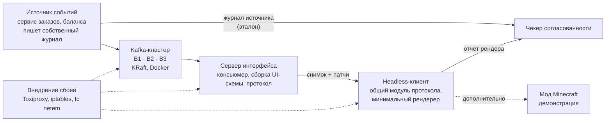

# Протокол доставки состояния серверно-управляемого интерфейса с версиями поддеревьев и его оценка при сбоях доставки через Apache Kafka

*Англоязычное название: Subtree-Versioned State Delivery for Server-Driven UI and Its Evaluation under Delivery Failures in Apache Kafka Pipelines.*

Исследуем, что видит пользователь, когда интерфейс описывает сервер, данные для него идут через Apache Kafka, а в цепочке доставки происходит сбой. Предлагаем протокол доставки обновлений интерфейса с версиями поддеревьев (S4) и сравниваем его с обычными номерами версий (S3) и с сильным практическим вариантом (S5) на стенде с настоящим Kafka-кластером. Визуальная часть на Minecraft остаётся дополнительной: она делается, если останется время.

## 1. Проблема и актуальность

В серверно-управляемом интерфейсе (Server-Driven UI, BDUI) сервер присылает клиенту не только данные, но и описание экрана: компоненты, вёрстку, действия. Так работают крупные мобильные приложения, например Ghost Platform в Airbnb [12]. Это позволяет менять интерфейс без выпуска новой версии приложения [13, 14]. Отраслевая оценка подхода и его рисков приведена в [15].

Данные для такого интерфейса всё чаще приходят из событийно-ориентированного бэкенда через брокер сообщений, чаще всего Apache Kafka [1, 2]. По умолчанию Kafka гарантирует доставку «хотя бы один раз», а порядок сохраняет только внутри одной партиции [1, 5]. При сбоях сообщения дублируются, приходят не по порядку, а при некоторых настройках теряются [3].

Нарушения гарантий в подобных системах находят и независимые проверки. В 2024 году Jepsen проверил Bufstream, Kafka-совместимую систему, и описал нарушения заявленных гарантий [4]. Сам Apache Kafka в этом отчёте не проверялся, поэтому отчёт показывает класс проблем Kafka-совместимых систем, но не доказывает их наличие в Kafka.

Для бэкенда эти эффекты хорошо изучены. Для интерфейса в изученных источниках остаются без ответа вопросы: какую долю времени пользователь видит неверные данные, насколько они устаревают и за какое время интерфейс восстанавливается. Готовые практики описаны в инженерных статьях: снимок плюс версионированные дельты, переподключение с повторной отрисовкой (как в Phoenix LiveView [16]), идемпотентный консьюмер со снимками в компактном топике. Однако, насколько нам удалось найти (раздел 3.2), эти практики не сравнивались на реальных сбоях.

### Исследовательские вопросы

Общий вопрос: как доставлять состояние серверно-управляемого интерфейса так, чтобы при сбоях в цепочке доставки (источник событий, Kafka, сервер интерфейса, клиент) пользователь не видел невозможных состояний, а после сбоя интерфейс быстро сходился к истинному состоянию, и какой ценой по трафику и задержке.

- **RQ1.** Как часто и как долго разные стратегии доставки показывают нарушение безопасности при сбоях разных типов?
- **RQ2.** Выигрывает ли S4 у S3 и у сильного практического варианта S5 по времени сходимости и объёму трафика восстановления, не ухудшая безопасность?
- **RQ3.** Какую цену платит S4 за независимые версии поддеревьев: как часто на экране оказываются данные из разных моментов, которых вместе никогда не было?

## 2. Цель и задачи

**Цель:** разработать протокол доставки состояния серверно-управляемого интерфейса с версиями поддеревьев и экспериментально оценить его относительно базовых стратегий при сбоях в цепочке доставки через Apache Kafka.

**Задачи:**

1. Провести обзор подходов к BDUI, гарантий доставки Kafka и методов проверки согласованности распределённых систем (с протоколом поиска).
2. Сформулировать критерий согласованности интерфейса, включая согласованность между поддеревьями, и метрики для его оценки.
3. Разработать протокол S4 и клиентскую логику в общем модуле, реализовать минимальный рендерер, достаточный для экспериментов.
4. Реализовать базовые стратегии S3 и S5, а также S1 как нижнюю контрольную точку.
5. Построить стенд: Kafka-кластер, подсистему внедрения сбоев, журнал источника событий и чекер согласованности.
6. Проверить чекер на подсаженных нарушениях, зафиксировать сценарии и критерии успеха, провести основные прогоны и проанализировать результаты.

**Объект исследования:** серверно-управляемые пользовательские интерфейсы в событийно-ориентированных системах.

**Предмет исследования:** протоколы доставки состояния интерфейса и их поведение при сбоях в цепочке доставки через брокер сообщений.

**Объём работы.** Ядро работы — сравнение протокола S4 с S3 и S5 на headless-клиентах и чекер. Дополнительно, при наличии времени, делаются мод Minecraft, стратегия S2 и расширенный набор компонентов рендерера.

## 3. Научная новизна и связанные работы

### 3.1. Ранний черновик State-of-the-Art

| Работа | Что делает | Чего не делает |
|---|---|---|
| Phoenix LiveView [16] | Строит серверные различия (диффы) интерфейса, использует отпечатки статических частей. После разрыва соединения экран перерисовывается целиком | В использованных материалах не описаны сбои брокера как источника данных, восстановление на уровне поддерева и количественная оценка согласованности |
| Airbnb Ghost Platform [12] | Промышленный BDUI: секции, экраны, действия | В статье не описаны гарантии доставки обновлений при сбоях транспорта и нет оценки поведения при сбоях |
| BDUI-работы [13, 14] | Академическое описание BDUI и фреймворка. Надёжность сети названа среди открытых проблем [13] | Не предлагают и не оценивают протокол доставки при сбоях |
| Elle [7] | Проверяет изоляцию транзакций по истории, которую наблюдают клиенты, с внедрением сбоев | Работает с базами данных, а не с отрисованным интерфейсом. Не определяет согласованность представления, производного от потока событий |
| PBS [9] | Оценивает устарелость реплик в версиях и во времени | Рассматривает кворумные хранилища, а не интерфейс и не цепочку Kafka |
| CRDT [10] | Обеспечивает сходимость реплик при повторной и неупорядоченной доставке | Требует коммутативных операций. Не задаёт критерий безопасности для отображаемого состояния |

### 3.2. Протокол поиска

Утверждение об отсутствии подобных сравнений опирается на описанный ниже поиск.

- **Базы:** Google Scholar, ACM Digital Library, IEEE Xplore, arXiv, dblp, а также eLibrary и КиберЛенинка для русскоязычных работ.
- **Дата поиска:** ____.
- **Критерии отбора:** публикации 2015 года и позже, в которых рассматривается доставка состояния интерфейса при сбоях транспорта или брокера.
- **Предлагаемые запросы:** `"server-driven UI" consistency`, `"server-driven UI" fault tolerance`, `"backend-driven UI" reliability`, `Kafka UI state consistency`, `live view reconnect resynchronization`, `stale UI event-driven`, `BDUI согласованность`, `серверно-управляемый интерфейс отказоустойчивость`.

| Запрос | База | Найдено | Просмотрено | Релевантных | Примечание |
|---|---|---|---|---|---|
| | | | | | |

### 3.3. Новизна (выводится из столбца «Чего не делает»)

- **Протокол.** Версии отдельных поддеревьев и ресинхронизация на их уровне при сбоях доставки через Kafka. Ближайший аналог [16] перерисовывает экран целиком, а вариант S3 использует одну версию на весь экран.
- **Критерий и чекер.** Критерий согласованности отображаемого состояния, который учитывает и согласованность между поддеревьями, а также чекер, у которого истина берётся из журнала источника событий, независимого от брокера.
- **Сравнение.** Сопоставление S4 с S3 и с сильным практическим вариантом S5 на настоящем Kafka-кластере с управляемым внедрением сбоев. Сравнений такого рода в рамках поиска (раздел 3.2) не найдено.

### Практическая значимость

- Протокол и выводы переносятся на мобильные и веб-приложения с BDUI и живыми обновлениями.
- Чекер можно использовать для тестирования интерфейсов поверх событийного бэкенда.
- Стенд пригоден как учебная среда по распределённым системам.

## 4. Предлагаемое решение

*Рис. 1. Архитектура стенда. Пунктиром показаны точки внедрения сбоев и дополнительный компонент.*

**Минимальный рендерер.** Схема экрана состоит из небольшого набора компонентов (текст, список, кнопка, контейнер), серверный DSL написан на Kotlin. За основу формата можно взять подмножество открытого BDUI-формата. Полноценный фреймворк не разрабатывается.

**Протокол S4.** У каждого поддерева экрана своя версия. Патч указывает версию, к которой он применяется, поэтому повторное применение безопасно. Обнаружив пропуск, клиент запрашивает снимок только повреждённого поддерева. Идея отпечатков поддеревьев близка к [16], но там после разрыва перерисовывается весь экран.

**Стенд и внедрение сбоев.** Брокеры Kafka работают в Docker. Сбои вносятся через Toxiproxy, iptables и tc netem, а управляются через HTTP API подсистемы сбоев, который использует и скрипт прогонов. Подход следует принципам chaos engineering [6] и методологии Jepsen [4, 7].

**Эталон чекера (истина).** Источник событий до отправки в Kafka дописывает каждое событие в собственный журнал (append-only) с логическим номером. Истинное состояние в любой момент строится по этому журналу, а не по журналу Kafka. Это важно для сбоя F2: когда подтверждённые записи теряются, в Kafka их уже нет, но в журнале источника они остаются, и чекер видит потерю. Журнал источника и отчёты клиента пишутся в общем формате трассы (раздел 7).

**Чекер.** Сравнивает то, что клиент реально отрисовал (отчёты рендера), с последовательностью истинных состояний из журнала источника. Идея проверки по наблюдаемой истории операций взята из [7, 8].

### Критерий согласованности интерфейса

Пусть источник породил последовательность состояний данных `D0, D1, ..., Dn`, а поддеревья экрана `A, B, ...` показывают проекции этих данных.

- **Безопасность на уровне поддерева.** В любой момент каждое отображаемое поддерево соответствует проекции некоторого состояния `Dk`, которое источник уже подтвердил. Состояние, которого никогда не было (например, баланс после дубля списания), пользователь не видит.
- **Безопасность на уровне экрана (между поддеревьями).** Комбинация версий, показанная на экране, должна соответствовать одному состоянию `Dk`. Нарушение выглядит так: на экране баланс из момента `Di`, а список заказов из момента `Dj`, и такого сочетания в истории источника не было. У S4 версии поддеревьев независимы, поэтому это её основное ограничение. Мы измеряем его (метрика M6), а не скрываем.
- **Сходимость.** После прекращения сбоев каждое поддерево за конечное время приходит к последнему подтверждённому состоянию. Время сходимости измеряется.
- **Устарелость.** Отставание отображаемого состояния от истинного оценивается в версиях и в миллисекундах по аналогии с метрикой PBS [9].

Формулировки критерия опираются на модели согласованности из [11]. Требование, чтобы отображаемая версия не откатывалась назад, соответствует гарантии монотонного чтения [19].

Дополнительно, если останется время, исследуется расширение S4 группами согласованности: связанные поддеревья получают общую версию и обновляются атомарно. Это снижает M6 ценой более крупной ресинхронизации.

### Дополнительная часть: стенд в Minecraft

Ни протокол, ни чекер от Minecraft не зависят. Основные прогоны идут на headless-клиентах с тем же кодом протокола. Мод делается только после завершения ядра и служит для демонстрации и ручных экспериментов:

- брокеры Kafka показаны блоками-стойками, лампы отражают реальное состояние кластера (данные из Kafka AdminClient);
- действия игрока (срезать кабель, остановить брокер, вызвать ребалансировку) вызывают тот же HTTP API подсистемы сбоев, что и скрипт прогонов;
- предмет «телефон» открывает BDUI-экран, а табло показывает стратегию, долю неверных данных и журнал нарушений.

Пример демонстрации: при S1 ребалансировка приводит к невозможному балансу на телефоне и красному табло, а при S4 тот же сбой перерисовывает только затронутый блок экрана.

Minecraft как платформа для системных исследований уже используется [17, 18].

## 5. Методика эксперимента

### 5.1. Стратегии доставки

| Код | Стратегия | Статус | Ожидаемое поведение |
|---|---|---|---|
| S1 | Наивные патчи: событие сразу превращается в изменение экрана | Контрольная точка (показывает, что чекер ловит нарушения) | Дёшево, но расходится при дублях и потерях |
| S3 | Снимок плюс дельты с одной версией на весь экран (обычные sequence numbers) | Основная база | Сходится, но при пропуске перезагружает весь экран |
| S5 | Идемпотентный консьюмер плюс компактный топик со снимками [20] | Основная база (практический вариант) | Сильная практическая стратегия; ожидаемая цена — трафик и задержка при восстановлении |
| S4 | Предлагаемый протокол: версии поддеревьев, идемпотентные патчи, частичная ресинхронизация | Предлагаемое решение | Гипотеза в разделе 5.4 |
| S2 | Полный снимок экрана на каждое событие | Дополнительно | Верхняя оценка трафика |

### 5.2. Сбои в цепочке доставки и параметр конфигурации

Все сбои относятся к цепочке «источник → Kafka → сервер интерфейса → клиент».

| Код | Сбой | Что ожидаем увидеть |
|---|---|---|
| F1 | Сетевой разрыв между брокерами | Задержки, смена лидера партиции |
| F2 | Потеря лидера при `acks=1` | Потеря подтверждённых сообщений |
| F3 | Ребалансировка группы консьюмеров | Повторная доставка, дубли |
| F4 | Падение и перезапуск сервера интерфейса | Потеря состояния консьюмера, повтор с последнего коммита |
| F5 | Разрыв и переподключение клиента | Пропуск патчей на стороне клиента |

**Параметр P (не сбой).** Это партиционирование событий экрана: P1 — одна партиция на экран, P2 — события разных поддеревьев в разных партициях (порядок между ними не гарантирован). Основные прогоны идут при P2 как в более тяжёлом режиме, а контрольные прогоны при P1 показывают вклад партиционирования.

### 5.3. Метрики

| Код | Метрика | Единица |
|---|---|---|
| M1 | Доля времени, когда интерфейс нарушал безопасность (уровень поддерева) | % |
| M2 | Максимальная и медианная устарелость | версии, мс |
| M3 | Время сходимости после окончания сбоя | мс |
| M4 | Объём трафика от сервера к клиенту | байт на событие и за период восстановления |
| M5 | Задержка от события в источнике до отрисовки | мс, p50 и p99 |
| M6 | Доля времени, когда комбинация версий поддеревьев не соответствует ни одному состоянию истории (безопасность между поддеревьями) | % и длительность, мс |

### 5.4. Гипотеза и критерий подтверждения (фиксируются до основных прогонов)

**H1.** При сбоях F3, F4 и F5 протокол S4 по сравнению с S3 и S5:

- не ухудшает M1 (разница не значима по доверительному интервалу) и
- сокращает медиану M3 не менее чем на **X %** или снижает M4 за период восстановления не менее чем в **Y** раз.

**H2 (ограничение).** Ожидается, что значение M6 у S4 выше, чем у S3. Эта разница измеряется как цена независимых версий поддеревьев.

Начальные значения X и Y выбираются по пилотным прогонам (по 5 прогонов на пару), а затем фиксируются вместе со сценариями в документе предварительной регистрации с датой. Предварительные значения: X = 30 %, Y = 2. Если порог не достигнут, результат всё равно записывается как граница применимости S4.

### 5.5. Статистика и валидность

- **Число прогонов:** не менее 30 на пару «стратегия × сбой» при одинаковой нагрузке и одинаковом наборе случайных зёрен для всех стратегий.
- **Единица сравнения:** один прогон (одно значение метрики за прогон).
- **Доверительные интервалы:** bootstrap, 10 000 повторных выборок, уровень 95 %, для медиан и для разностей медиан между стратегиями при парных зёрнах.
- **Предварительная регистрация:** сценарии, метрики, пороги X и Y и число прогонов фиксируются в документе с датой и тегом репозитория до основных прогонов. Пилот в итоговые данные не входит.
- **Проверка чекера:** в трассы подсаживаются известные нарушения: пропуск, дубль, перестановка, устаревшее значение, смесь версий разных поддеревьев. Мы отчитываемся о доле найденных нарушений и о ложных срабатываниях на чистых трассах.
- **Объём:** 4 стратегии (S1, S3, S4, S5) × 5 сбоев × 30 прогонов = 600 прогонов основной серии. Время одного прогона оценивается на пилоте.

Итог — таблицы «стратегия × сбой» по каждой метрике с доверительными интервалами.

## 6. План работ

План рассчитан на период с октября 2026 года по июнь 2027 года. Части A и B выполняются параллельно, общие этапы вынесены в отдельный столбец (раздел 7).

| Месяц | Совместно | Часть A: протокол и клиент | Часть B: стенд и оценка |
|---|---|---|---|
| Октябрь 2026 | Формат трассы событий. Первичный поиск литературы по протоколу из раздела 3.2 | Обзор источников по BDUI. Черновик спецификации S4. Начало главы 2 (BDUI) | Обзор источников по Kafka и проверке согласованности. Локальный Kafka-кластер в Docker. Начало главы 2 (Kafka, чекеры) |
| Ноябрь 2026 | Главы 1 и 2 в черновом варианте. Черновик сценариев и метрик | Формальный критерий согласованности, включая согласованность между поддеревьями. Схема экрана и дизайн минимального рендерера | Источник событий с журналом. Подсистема внедрения сбоев, ручное воспроизведение F1–F5 |
| Декабрь 2026 | Сквозной запуск «источник → Kafka → сервер → клиент» на стратегии S1 | Клиентский модуль протокола, headless-клиент, стратегии S1 и S3 | Автоматизация сбоев через HTTP API. Стратегия S5 (консьюмер, офсеты, компактный топик) |
| Январь 2027 | Зимняя сессия, объём работ снижен: правки глав 1 и 2 | Серверная часть S4: патчи, версии поддеревьев | Чекер, первая версия: безопасность на уровне поддерева, сходимость, устарелость |
| Февраль 2027 | Промежуточный отчёт по первой половине работы | Завершение S4: ресинхронизация поддеревьев, тесты на дубли и пропуски | Чекер, вторая версия: согласованность между поддеревьями (M6). Проверка чекера на подсаженных нарушениях |
| Март 2027 | Пилотные прогоны (по 5 на пару), выбор X и Y, документ предварительной регистрации с тегом репозитория | Доработка S4 по итогам пилота. Анализ M6; при наличии времени группы согласованности | Скрипт серии прогонов, нагрузка ботов, сбор и хранение трасс. Оценка времени одного прогона |
| Апрель 2027 | Основные прогоны (около 600) | Участие в разборе трасс с нарушениями безопасности, проверка поведения S4 и S3 | Запуск и мониторинг серии, сбор данных, проверка их полноты |
| Май 2027 | Анализ результатов, выводы, ограничения. Решение о Minecraft-моде | Текст: протокол, клиент, результаты по M3, M4, M6. Мод Minecraft и стратегия S2 при наличии времени | Текст: стенд, чекер, методика, статистика (bootstrap, доверительные интервалы), результаты по M1, M2, M5 |
| Июнь 2027 | Оформление по ГОСТ, список литературы, презентация, предзащита и защита | Итоговая редакция своей части | Итоговая редакция своей части |

## 7. Разделение работы между двумя студентами

**Общий интерфейс: формат трассы событий.** Записи источника содержат логический номер, ключ поддерева, значение и время. Записи клиента содержат информацию о том, что и в какой версии отрисовано, и время. Формат согласуется в октябре–ноябре, так как от него зависят обе части.

- **Часть A: протокол и клиент.** Спецификация и реализация S4 (включая серверную часть, которая собирает патчи и снимки из потока Kafka) и S3, реализация S1, минимальный рендерер, анализ согласованности между поддеревьями (M6, группы согласованности). Консультации по работе консьюмера и офсетов даёт часть B.
- **Часть B: стенд и оценка.** Kafka-кластер, источник событий с журналом, внедрение сбоев, реализация S5 (идемпотентный консьюмер и компактный топик со снимками), чекер, проверка чекера на подсаженных нарушениях, план эксперимента и статистика.
- **Совместная работа:** связанные работы и протокол поиска (источники делятся между студентами), введение, итоговое обсуждение результатов. У каждой части есть отдельный названный вклад в итоговый текст.

## 8. Риски и меры

| Риск | Мера |
|---|---|
| Объём не помещается в отведённое время | Ядро: S4 против S3 и S5 на headless-клиентах и чекер. Minecraft, S2 и группы согласованности делаются по остаточному принципу |
| Сбои Kafka воспроизводятся нестабильно | Используются сценарии с гарантированным эффектом (F2–F5). Сложные аномалии транзакций в объём не входят |
| Чекер пропускает нарушения | Проверка на подсаженных нарушениях до основных прогонов, отчёт о доле найденных |
| S4 не превзойдёт S3 или S5 | Результат всё равно ценен: он показывает границы применимости стратегий. Порог фиксируется заранее |
| Независимые версии поддеревьев дают рассогласование на экране | Рассогласование измеряется как M6 и записывается как ограничение S4 |
| Вопрос «зачем Minecraft» | Он дополнительный. Протокол и чекер от него не зависят |

## 9. Основные источники

### Kafka и гарантии доставки

1. Kreps J., Narkhede N., Rao J. [Kafka: a Distributed Messaging System for Log Processing](https://people.csail.mit.edu/matei/courses/2015/6.S897/readings/kafka.pdf) // NetDB Workshop. 2011.
   *Исходная статья о Kafka.*
2. Wang G. et al. [Consistency and Completeness: Rethinking Distributed Stream Processing in Apache Kafka](https://doi.org/10.1145/3448016.3457556) // SIGMOD 2021. P. 2602–2613.
   *Как Kafka обеспечивает exactly-once и обрабатывает данные не по порядку.*
3. [Race Conditions in Kafka Microservices: Handling Out-of-Order Events](https://medium.com/@sanskaragr.14/race-conditions-in-kafka-microservices-handling-out-of-order-events-and-data-overwrites-in-cc2a61c44957) // Medium.
   *Инженерный пример того, как нарушение порядка приводит к неверному статусу у пользователя.*
4. Kingsbury K. [Jepsen: Bufstream 0.1.0](https://jepsen.io/analyses/bufstream-0.1.0). 2024.
   *Независимый анализ Kafka-совместимой системы Bufstream (не самого Apache Kafka).*
5. Apache Kafka Documentation. [Message Delivery Semantics](https://kafka.apache.org/documentation/#semantics). Apache Software Foundation.
   *Официальное описание гарантий доставки и порядка. Источник для утверждений о поведении Kafka по умолчанию.*

### Внедрение сбоев и проверка согласованности

6. Basiri A. et al. [Chaos Engineering](https://arxiv.org/pdf/1702.05843) // IEEE Software. 2016. Vol. 33, No. 3. P. 35–41.
   *Принципы экспериментов с внедрением сбоев (Netflix).*
7. Kingsbury K., Alvaro P. [Elle: Inferring Isolation Anomalies from Experimental Observations](https://doi.org/10.14778/3430915.3430918) // PVLDB. 2021. Vol. 14, No. 3. P. 268–280.
   *Проверка корректности по истории, которую наблюдают клиенты. Основа подхода чекера.*
8. Herlihy M., Wing J. [Linearizability: A Correctness Condition for Concurrent Objects](https://doi.org/10.1145/78969.78972) // ACM TOPLAS. 1990. Vol. 12, No. 3. P. 463–492.
   *Классическое определение согласованности.*
9. Bailis P. et al. [Probabilistically Bounded Staleness for Practical Partial Quorums](https://arxiv.org/pdf/1204.6082) // PVLDB. 2012. Vol. 5, No. 8. P. 776–787.
   *Метрика устарелости в версиях и во времени. Основа метрики M2.*
10. Shapiro M. et al. [Conflict-free Replicated Data Types](https://doi.org/10.1007/978-3-642-24550-3_29) // SSS 2011. LNCS 6976. P. 386–400.
    *Сходимость реплик при повторной и неупорядоченной доставке.*
11. Viotti P., Vukolić M. [Consistency in Non-Transactional Distributed Storage Systems](https://doi.org/10.1145/2926965) // ACM Computing Surveys. 2016. Vol. 49, No. 1.
    *Обзор моделей согласованности. Опора для формулировки критерия безопасности между поддеревьями.*

### Серверно-управляемый интерфейс

12. Brooks R. [A Deep Dive into Airbnb’s Server-Driven UI System](https://medium.com/airbnb-engineering/a-deep-dive-into-airbnbs-server-driven-ui-system-842244c5f5). Airbnb Engineering, 2021.
    *Промышленная BDUI-платформа: секции, экраны, действия.*
13. Smith E. [A Case Study of Server Driven UI in the Development of Mobile Applications](https://scholarworks.calstate.edu/concern/theses/8s45qk91j). Master’s thesis, CSU San Marcos, 2025.
    *Академический разбор BDUI. Надёжность сети названа среди открытых проблем.*
14. Sharma N., Tripathi R. N., Tripathi V. [FreeFlow: A framework for server-driven mobile apps](https://www.sciencedirect.com/science/article/pii/S2772569325000271) // Science Talks. 2025. Vol. 14.
    *Пример BDUI-фреймворка в научной публикации.*
15. [Server-driven UI](https://www.thoughtworks.com/radar/techniques/server-driven-ui). Thoughtworks Technology Radar.
    *Отраслевая оценка подхода и его рисков.*
16. [Latency and rendering optimizations in Phoenix LiveView](https://dashbit.co/blog/latency-rendering-liveview). Dashbit; [Deployments and recovery](https://hexdocs.pm/phoenix_live_view/deployments.html), Phoenix LiveView docs.
    *Ближайший аналог: серверные диффы интерфейса с отпечатками поддеревьев. После разрыва экран перерисовывается целиком.*

### Minecraft как среда для системных исследований (дополнительная часть)

17. Eickhoff J., Donkervliet J., Iosup A. [Meterstick: Benchmarking Performance Variability in Cloud and Self-hosted Minecraft-like Games](https://dl.acm.org/doi/10.1145/3578244.3583724) // ICPE 2023.
    *Рецензируемое системное исследование на базе Minecraft-подобных игр.*
18. van der Sar J., Donkervliet J., Iosup A. Yardstick: A Benchmark for Minecraft-like Services // ICPE 2019.
    *Второй пример системного бенчмарка на Minecraft-подобных сервисах.*

### Теория и практика согласованности

19. Terry D. B. et al. Session Guarantees for Weakly Consistent Replicated Data // PDIS 1994.
    *Гарантии сессии, в том числе монотонное чтение: интерфейс не должен «откатываться» назад.*
20. Kleppmann M. Designing Data-Intensive Applications. O’Reilly, 2017.
    *Практическая база по идемпотентности, журналам и компактным топикам. Опора для стратегии S5.*
